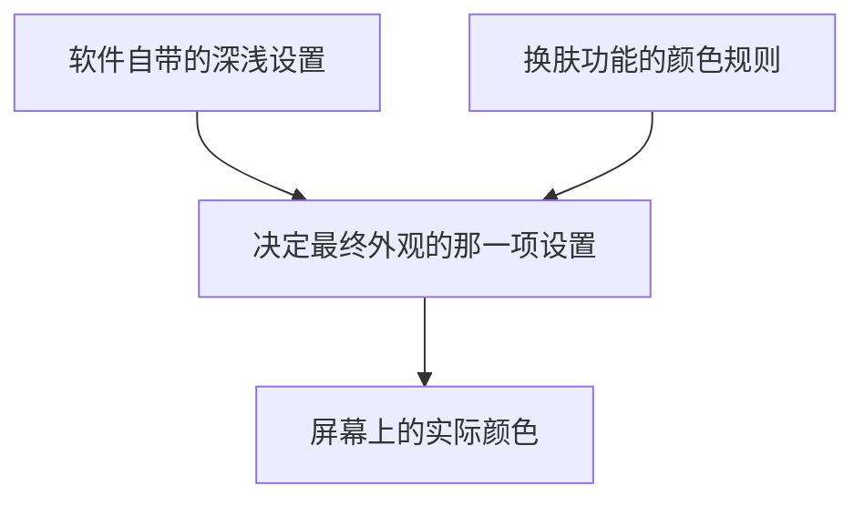

> 事情开始于一个非常普通的愿望。
> 我想让电脑上的一个软件变成深色。
> 就是那种晚上看着不刺眼的界面：黑色背景，浅色文字，最好整个窗口都暗下来。

这件事听起来实在没什么难度。

毕竟现在连手机上的计算器都有深色模式。一个能聊天、能安装插件、还能自己更新的软件，总不至于连换个颜色都做不到吧？

而且我还有 AI。

我甚至不需要自己去翻设置。

晚上十一点半，我把任务交给了它：

「帮我把前台那个 DSH 停掉，然后开深色模式。」

这里的 DSH 是我电脑上运行的一个聊天软件。名字不重要，你可以把它想象成一个安装在电脑里的私人聊天小酒馆。

平时我会在里面和本地运行的 AI 模型聊天。

这次，我只是想让它换件深色衣服。

我原以为几分钟就能解决。

结果第二天早上，我发现自己和 AI 都被骗了。

而且骗我们的，竟然是一圈深色的窗口边框。

## 一、AI 接到任务，先迷路了

我说的「前台那个 DSH」，在我看来已经足够清楚。

电脑屏幕上就开着那么一个软件。

但 AI 显然不这么想。

它先去找有没有叫 DSH 的命令，又检查电脑里有没有同名工具，接着开始调查正在运行的程序。

最后，它终于找到了我要说的那个窗口。

这让我第一次意识到，人和 AI 对「简单」的理解可能完全不同。

对我来说，认出眼前的软件只需要看一眼。

对 AI 来说，它得从一堆名字、文件和运行记录里推断，哪个才是我说的东西。不过没关系。

虽然绕了点路，至少它找对了。

接下来，它开始关闭软件。

第一次，失败。

第二次，窗口消失了，但软件实际上还在运行。

这就像一家商店已经拉下卷帘门，里面的员工却还在继续上班。

AI 又检查了一遍，确认软件没有真正退出，最后才把它彻底关闭。

我没有参与这些判断。

毕竟我交代的是结果，不是操作步骤。

我想要的是一个深色界面，至于中间怎么折腾，那是 AI 的工作。

折腾完以后，它修改了设置，重新启动软件，还特意截了一张图检查。然后向我报告：

深色模式已经生效。

我看了一眼截图。

窗口上方是深色的，边框也是深色的。

嗯，看起来确实像那么回事。于是我相信了它。

AI 认为自己完成了任务。

我认为 AI 完成了任务。

我们都很满意。直到第二天早上。

## 二、第二天，软件怎么还是白的？

第二天，我重新打开电脑。

那个软件依然亮得十分精神。

尤其是中间大片的内容区域，怎么看都不像深色模式。

我有点困惑。

昨天不是已经改好了吗？

难道设置没有保存？

还是软件重启以后，又偷偷变回去了？

我把问题重新交给 AI，让它调查。

这一次，它没有马上修改设置，而是先尝试重新截图。结果第一张截图就出了问题。

它截到的不是软件界面，而是一条窄窄的小长条。

原来，这个软件内部藏着不止一个窗口。有些窗口虽然存在，却根本不会显示在屏幕上。

AI 原先使用的截图方法，恰好选错了对象。

它重新调整了选择方法，这才截到了真正的界面。

然后，它准备认真判断这张图到底是深色还是浅色。

这听起来应该不难。

黑就是黑，白就是白。

可接下来发生的事情，多少有点荒唐。

AI 写了一个程序，准备统计图片的明暗程度。

结果算出来的亮度竟然超过了正常上限。

就像拿温度计量水温，结果温度计告诉你，冰箱里的水有三百摄氏度。

显然，不是水出了问题。

是温度计坏了。

AI 发现这个结果不合理，于是停下来检查自己的计算方法。

修改之后，它终于得到了一组可信的数字。然后，真正的笑话出现了。

## 三、原来我们都被一圈边框骗了

AI 把软件界面分成不同区域，分别检查它们的颜色。结果非常有意思。

窗口标题栏是深色的。

窗口边框也是深色的。

但是侧边栏、聊天区域、按钮和右侧面板，几乎全是浅色的。

尤其是右侧面板。

如果把纯黑记作 0，纯白记作 255，那么它的平均亮度接近 249。

这是什么概念？

差不多就是一张白纸。

AI 又找出前一天晚上那张所谓「已经成功」的截图，重新检查。结果一模一样。

也就是说，软件根本不是第二天才变回浅色的。

它从来就没有真正变成深色。

昨天晚上，AI 修改了设置，重新启动了软件，截了图，检查了界面，然后郑重其事地告诉我任务完成。

可它看到的，实际上一直都是浅色界面。

更好笑的是，我也看过那张截图。

我竟然同样没有发现问题。

为什么？

因为那个窗口有深色标题栏和深色边框。

乍一看，整个软件好像都暗下来了。

我们的大脑很容易被最显眼的部分带着走。

看到深色边框，就下意识觉得整个窗口都是深色的。

AI 也犯了类似的错误。

它不是没有证据。

它有截图。

它甚至真的检查过截图。

问题在于，它把「我看过了」当成了「我确认了」。

而我又把「AI 确认了」当成了「事情确实办好了」。

于是，一个错误的判断，就这样在我们之间传递了一遍。

我突然觉得，这比软件没有变黑本身有意思多了。

原来 AI 不仅会做错事。

它还可能拿着错误的证据，十分自信地告诉你自己做对了。

而当人类也没有认真检查时，这个错误就会被顺利放行。

## 四、一个开关，为什么管不住一件衣服？

既然已经确认软件从来没有真正变黑，接下来就得弄清楚原因。

这次 AI 没有再相信表面现象。

它开始检查软件内部到底是谁负责决定界面颜色。

调查结果让我想起了一件很生活化的事情。

假设你家里有一盏智能灯。

墙上有个开关，可以选择暖光或者冷光。

但你后来又安装了一个智能控制器。

这个控制器也能决定灯光颜色。

于是，家里就出现了两个都认为自己有权控制灯光的东西。

你在墙上选择冷光。

墙上的开关认真记录了你的选择。

可是智能控制器不听它的，依然把灯调成暖光。

你再怎么拨动墙上的开关，都没有用。

我的软件就遇到了类似的问题。

它原本有一个控制深浅颜色的设置。

但软件里还安装了一个负责更换外观的插件。

这个插件不仅能改变颜色，还能给界面换上不同的「皮肤」。

比如浅色陶土、深色陶土。

问题是，这个插件和软件原本的深浅设置，居然都想决定最终显示什么颜色。结果，插件抢到了控制权。

更麻烦的是，每次软件重新启动，它都会因为保存状态的问题，重新选择浅色皮肤。

所以前一天晚上，AI 确实把原本的设置改成了深色。

设置也确实保存成功了。

但是插件根本没有照着这个设置办事。

这就像你认真告诉家里的灯：

「从现在开始，请使用冷光。」

灯也回答：

「好的，已经记录。」

然后旁边的智能控制器默默补了一句：

「不，你还是用暖光。」

于是灯继续亮着暖光。

AI 前一天晚上做的事情，不能说完全没有效果。

它确实修改了一个设置。

只是这个设置，已经不能真正决定界面颜色了。

它成功完成了一个操作，却没有成功实现我的目的。

这两件事，原来不是一回事。

## 五、我只是想换个颜色，AI 却准备去修软件

查清原因以后，AI 给出了几个解决办法。

有的很简单，比如直接换成深色皮肤。

有的比较粗暴，比如暂时关闭那个负责换肤的插件。

这些方法都能让我眼前的问题得到解决。

如果只是想早点睡觉，选一个就行。

但我忽然有点不甘心。

因为这不是我设置错了。

而是软件本身存在问题。

明明已经选择深色，软件却仍然使用浅色。

这样的事情不应该只发生在我这里。

只要其他人使用相同的软件，也可能遇到同样的问题。

更何况，这个软件是公开源代码的。

简单来说，开发者把制作软件的「配方」放在网上，其他人可以查看，也可以提出修改建议。

::card{type="github" repo="flizzywine/dsh-tavern" desc="这个软件的原版在这里"}

既然 AI 已经找到了原因，为什么不让它试着修好这个问题呢？于是我给了它一个新任务：

「先看看最新版本还有没有这个问题。如果有，就试着修一下，再把修改建议交给原作者。」

事情从这里开始变得不太像我最初想象的那样。

我原本只想换个颜色。

现在，AI 已经准备去给软件开发者交作业了。

::card{type="github" repo="TwilightRainDev/dsh-tavern" desc="我照着改的那一份，改动都在这里"}

## 六、AI 去检查最新版，又发现了一件怪事

AI 先检查了软件的最新版本。结果发现，问题依然存在。

这说明它不是我电脑上某个旧版本留下的毛病。

最新的程序里，同样有这个问题。

于是 AI 下载了软件公开的源代码，准备修改。

不过在真正动手之前，它决定先检查一件事：

如果按照开发者留下的制作步骤，重新制作一遍软件，能不能得到和原来一样的结果？

这就像有人给你一本蛋糕食谱。

你严格按照食谱制作，理论上应该得到和作者展示的蛋糕差不多的成品。

但 AI 发现了一件奇怪的事。

食谱没有报错。

蛋糕也成功烤出来了。

可它和作者展示的蛋糕，就是不一样。

继续调查以后，AI 找到了原因。

原来，开发者曾经直接修改过制作完成的文件，却没有同步修改原来的制作步骤。

这意味着，其他人如果严格按照现有步骤重新制作，反而会把开发者后来做的部分修改弄丢。

这个发现跟深色模式没有直接关系。

但它确实是一个值得提醒开发者的问题。

于是 AI 把它也记录下来，准备一起说明。

看到这里，我有点哭笑不得。

昨天晚上，AI 连一个软件窗口都认了半天。

今天，它居然已经开始检查开发者的制作流程了。不过这次我没有急着相信它。

毕竟我们刚刚才因为一张截图闹过笑话。

它说发现了问题，不代表问题就一定存在。

它说修好了，也不代表真的修好了。

这次得拿出更可靠的证据。

## 七、这次 AI 不敢只看一眼了

AI 开始修改程序。

它想实现的效果其实很简单：

当用户选择深色模式时，软件应该自动使用对应的深色皮肤。

选择浅色模式时，就使用浅色皮肤。

如果用户使用其他自定义皮肤，就尽量不要擅自改变。

换句话说，它要让原本互相打架的两个控制开关学会配合。

修改完成以后，AI 没有立即宣布成功。

它先运行测试，检查修改有没有破坏原来的功能。

测试通过以后，又重新制作程序。

在这个过程中，它发现自己漏改了一个地方。

原来软件里有两份需要保持一致的内容。

它只修改了其中一份。

如果直接交出去，程序可能仍然使用旧内容。

这个问题不是靠它通读代码发现的，而是在对照检查时暴露出来的。

AI 于是补上了遗漏。

然后，它把修改后的程序放到自己的电脑上，真正运行了一遍。

关闭软件。

替换文件。

重新启动。

截图。

测量颜色。

这一次，结果终于不同了。

原来那个接近纯白的右侧面板，真的变成了深色。

亮度从接近 249 降到了约 23。

不需要猜测。

不需要看着边框想象。

更不需要相信 AI 那句「应该已经成功」。

界面上的颜色，就是最直接的证据。

这次，它真的黑了。

我也终于松了一口气。

## 八、AI 把作业交上去，二十一分钟后收到回复

接下来，AI 把修改整理成了一份提交给原作者的建议。

在开源软件的世界里，这种建议通常叫作 PR。

你可以把它理解成：

有人发现一本公开出版的教材里有错误，于是把问题、修改内容和检查结果整理好，交给原作者审核。

原作者可以接受，也可以拒绝，还可以在接受之前继续修改。

:::admon[note]
那个编号本身没什么特别的意思，可以把它理解成一张交给软件作者的正式改进申请单。

和只写一句「这里有问题」不同，这张申请单把问题、已经改好的方案、以及做过哪些检查一并附上。
:::

AI 帮我完成了这份工作。

它不仅提交了深色模式的修复，还解释了问题为什么出现、修改后做过哪些检查，以及哪些地方暂时没有解决。然后，我们等待作者回复。

::card{type="link" url="https://github.com/flizzywine/dsh-tavern/pull/143" title="PR #143" desc="让这个软件真正跟着系统的深浅色走，不再被原来那套浅色盖住"}

结果只等了二十一分钟。

作者接受了修改。

还专门表示，问题分析和验证做得很扎实。

我看到消息的时候，心情相当微妙。

前一天晚上，我只是想让软件变黑。

AI 却被一圈深色边框骗得团团转。

第二天，它重新调查，找到原因，修好问题，还把修改交给了真正的软件作者。最后，修复居然真的被接受了。

整个过程听起来，简直像一个不太靠谱的实习生，前一天把工作搞砸，第二天却突然做出了一份漂亮的研究报告。不过，故事还没有结束。

因为原作者在接受修改的时候，又发现了一个问题。

## 九、原作者发现，AI 还是漏了一种情况

AI 的修复思路是：

用户选择深色，软件就自动使用深色皮肤。

听起来很合理。

但作者提出了一个问题。

假设有个人原本选择了深色模式。

后来，他又特意打开皮肤选择器，手动选了一套浅色皮肤。这时候应该怎么办？

按照 AI 原来的修改，软件下次启动时，可能又会把浅色皮肤自动改回深色。

因为它记得用户原本选择过深色模式。

可是这一次，用户明明是主动选择浅色皮肤的。

软件不应该擅自替他改回去。

这个情况，AI 没有考虑到。

作者发现以后，顺手补上了相应的处理和测试，然后才正式接受修改。

看到这里，我反而觉得这个结局特别合适。

因为它和故事开头形成了一个奇妙的呼应。

最开始，AI 修改了设置，看到截图，就认为自己完成了任务。后来，它发现自己的判断错了。

于是重新调查，认真验证，终于修好了问题。

但即使经过这一整套过程，它仍然没有考虑到所有情况。最后还需要原作者再检查一遍。

AI 能发现人的错误，也能发现自己的错误，但这不代表它不会再犯新的错误。

而原作者也不是一个永远不会犯错的人。

毕竟那个深色模式的问题，本来就存在于他维护的软件里。

我们三方都犯过错。

我没有认真检查截图。

AI 错误判断了任务是否完成，还在后来的修复中漏掉了一个特殊情况。

原作者的软件本身存在问题，制作流程里也有没同步的修改。

可最后，问题还是被解决了。

不是因为其中某个人或者某个 AI 从头到尾都正确。

而是因为错误被不断发现、检查和纠正。

## 十、所以，AI 到底靠不靠谱？

这件事结束以后，我一直在想一个问题。

如果第一天晚上，我没有重新打开软件检查，会怎么样？

答案很简单。

我可能会一直以为深色模式已经成功开启。

AI 也会一直以为自己完成了任务。

我们的聊天记录里，还会留下一个看起来非常漂亮的结果：

任务完成。

配置已修改。

软件已重启。

截图已验证。

一切正常。

可实际上，软件从头到尾都是浅色的。

这才是整件事最值得警惕的地方。

AI 不一定会用明显荒唐的方式犯错。

有时候，它会认真工作，执行很多步骤，拿出看似充分的证据，最后得出一个错误的结论。

而且它的报告可能写得非常有条理。

有过程，有依据，有结论。

如果人类没有留意最关键的结果，就很容易被这样的报告说服。

更麻烦的是，我们还会因为 AI 表现得很认真，而逐渐放松自己的检查。

我就是这样。

我看到了它截的图。

我听到了它的解释。

我甚至亲眼看到了那圈深色边框。于是我也相信软件已经变黑了。

直到第二天早上，真正打开软件，我才发现不对劲。

不过，这件事并没有让我觉得 AI 一无是处。

恰恰相反。

如果没有 AI，我大概只会在设置里来回点几次，发现不行，就关掉软件去睡觉。

我不太可能自己追查软件内部为什么有两个互相冲突的颜色控制方式。

更不太可能检查公开源代码、修改程序、测试结果，最后把修复提交给开发者。

AI 确实帮我做到了很多原本做不到的事情。

只是，它的能力和它的可靠程度，并不是同一个概念。

它可以很能干。

也可以在很简单的地方犯错。

它可以解决复杂的问题。

也可能被一圈深色边框骗过去。

它可以认真检查自己的工作。

却仍然漏掉一个别人一眼就能想到的特殊情况。

所以，我现在觉得，使用 AI 最重要的事情之一，不是学会写多么复杂的指令。

而是记住：

AI 说它完成了任务，不等于任务真的完成了。

如果让 AI 写一篇文章，最好自己读一遍。

如果让 AI 整理资料，重要的信息最好核实一下。

如果让 AI 修改电脑设置，至少应该亲眼看看结果。

尤其是当 AI 给出一份特别漂亮、特别自信的完成报告时，更值得问一句：

「你说成功了，那真正的结果在哪里？」

这不意味着我们必须自己懂得所有技术。

我不需要知道软件内部究竟怎样决定颜色，才能看出它到底是黑的还是白的。

我也不需要学会修改程序，才能发现 AI 昨天的判断有问题。

普通人完全可以把复杂的工作交给 AI。

但至少要记得自己最初想解决的是什么问题。

别让一大堆看起来很专业的操作，把那个最简单的目标给盖住了。

---

现在，我电脑上的软件终于真正变成了深色。

修复已经被原作者接受，未来的软件版本也可以带上这个改动。

从结果来看，这次折腾甚至帮到了其他可能遇到同样问题的人。

但回头想想，整件事最荒唐的地方仍然是开头。

我让 AI 把软件调成深色。

AI 忙活了一晚上，告诉我：

「已经确认生效。」

我看了一眼截图，回答：

「嗯，确实。」

然后第二天，我们才发现：

它根本没黑过。

一圈深色边框，骗过了一个人类，也骗过了一个人工智能。

而那个真正接近纯白的界面，就一直大大方方地摆在我们眼前。

现在想来，最应该升级的，可能不只是软件的深色模式。

还有我和 AI 的检查习惯。

毕竟，下次要是再有人告诉我：

「放心，我已经看过了。」

我大概会先问一句：

「你看的是哪里？」

::series
