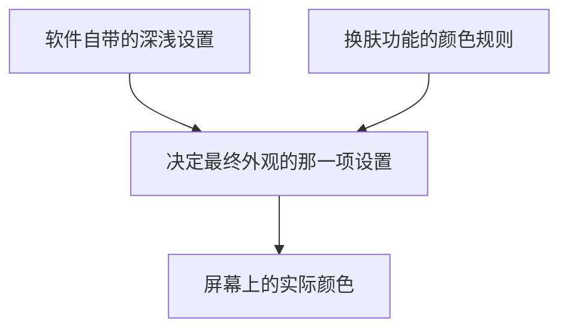

> 我只想要不那么刺眼的界面。
>
> 没过多久，AI 告诉我事情已经办好了。
>
> 第二天，我重新打开软件。

那天晚上十一点半，我准备结束一天的工作。

电脑屏幕上还开着一个平时经常使用的小众软件，叫DSHTarven，叫什么其实不重要。主要是它的界面是浅色的，大片白色背景在夜里显得格外刺眼。

我随手对 AI 丢了句，“帮我把这个软件关掉，切成深色。”

说完，我便把事情甩给了它。这本来是一件再普通不过的小事。就像让小爱同学把手机屏幕换成夜间模式。

我没有告诉它应该打开哪个文件、修改什么设置，也没有给它规定操作步骤。我不关心这些。

没过多久，AI 告诉我，事情已经办好了，软件已经重新启动，深色模式也已经生效。

还附上了张截图。我瞥了一眼。窗口边框是深色的，标题栏也是深色的。乍看之下，好像没啥问题。

直到第二天早上。我重新打开软件，哭笑不得，它还是白的。

## 一、AI 相信了自己的眼睛

如果只是普通的软件设置问题，故事到这里大概就结束了。无非是重新打开设置，找到深色模式，再点一次。

但这次，AI 没有简单地重复昨天的操作。它开始怀疑自己之前的判断。

昨天明明已经确认成功，为什么今天打开又变回去了？

是软件没有保存设置？是重新启动时恢复了默认状态？还是昨天那张截图本身就存在问题？

它决定重新调查。很快，它发现了意外。

原来，这个软件在电脑里并不只有一个窗口。有些窗口虽然存在，却不会显示在屏幕上。

AI 第一次尝试观察时，居然选中了几乎看不见的小窗口。

这就像想检查教室的灯有没有关，却误把储物间当成了教室。

它发现选错了地方，于是重新寻找真正的主窗口。

这次，它没有急着下结论，决定换一种更可靠的检查方式。

不再凭截图给人的整体印象判断，而是直接检查屏幕上不同位置的颜色。

为了让判断更准确，它还检查了自己使用的测量方法。

结果发现，测量方法本身也有问题。它先修正了测量方法，再重新检查界面。

这一次，答案终于清楚了。软件的标题栏确实是深色的。

但是，真正占据屏幕大部分面积的内容区域，依然是浅色的。

尤其是右侧那一大片背景，几乎接近纯白。

AI 又重新检查了前一天晚上那张被它宣布为“成功”的截图。

结果完全一样。也就是说，软件并非第二天才变回浅色的。

它从来就没有真正变成深色。

昨天晚上，AI 被深色的窗口边框误导了。

而我也被它的判断误导了。

人和 AI，就这样一起被截图骗了过去。

不过，真正有意思的事情才刚刚开始。

## 二、它发现，问题根本不在那个开关上

确认问题之后，AI 面临一个选择。

它可以继续寻找设置选项，尝试用其他方法打开深色模式。

也可以追问一个更根本的问题，为啥明明已经选择了深色，软件却依然显示浅色？

它选择了后者。

它发现，这个软件的外观实际上由几套不同的设置共同决定。

可以把它想象成一间教室。学校规定，晚上应该关掉最亮的顶灯，换成柔和的照明。

但教室里又安装了一套额外的智能照明系统。

这套系统有自己的怪癖，每次通电，都自动把灯光调回最亮的状态。

于是，学校的规定虽没变，教室却始终亮得刺眼。

这个软件遇到的正是类似的问题。

它本身有一套深浅模式设置。

但软件还安装了一套负责改变外观的“皮肤”。

这套皮肤有自己的颜色选择规则。

当两套规则发生冲突时，皮肤的规则总是占上风。

更麻烦的是，每次重新打开软件，皮肤都会重新选择浅色外观。

于是，无论怎样调整原来的深色开关，都无法真正解决问题。

AI 终于找到了原因，另一个功能不断把它覆盖掉了。

这意味着，继续折腾那个开关没有意义。

真正需要修复的是两套规则之间的矛盾。

## 三、从修好我的电脑，到修好软件本身

事情发展到这里，已经超出了我最初的要求。

我只是希望软件的背景暗一点。

但 AI 发现的问题，并不只属于我的电脑。

只要其他人使用相同的软件版本，就可能遇到同样的情况。

它开始考虑一个更长远的办法。

与其在我的电脑上反复修改设置，不如让软件本身学会正确处理深浅模式。

这就好比发现学校的照明系统每天都会自动把灯调亮。

临时解决办法，是每天晚上派保安去关灯。

更好的办法，则是修改照明系统的规则，让它以后都能正确执行要求。

AI 判断，后者才是值得采取的方向。

不过，在真正修改之前，它还需要弄清楚一件事，

这个问题是不是已经被软件作者修好了？

毕竟，软件一直在更新。

如果最新版已经解决了问题，再去修改旧版本，就没有必要了。

于是，它主动找到了软件公开发布的最新版本，仔细检查。

结果发现，问题依然存在。

::card{type="github" repo="flizzywine/dsh-tavern" desc="上游项目"}

这说明，它面对的绝非某台电脑偶然出现的小故障，而是软件本身尚未解决的缺陷。

接下来，AI 开始设计修复办法。

它没有选择最简单粗暴的方式。

例如，直接规定所有人打开软件时都使用深色。这样虽然能解决我的问题，却可能给喜欢浅色界面的人带来麻烦。

它也没有打算推翻原有的外观系统，重新做一套。

那样改动太大，容易引发新的问题。

经过比较，它选择了一种更稳妥的办法，

让软件原本的深浅设置，真正决定最终显示的颜色。

如果用户选择深色，就使用深色皮肤。

如果用户选择浅色，就使用浅色皮肤。

其他特殊外观则尽量保持原来的行为。

这样既能解决问题，又不必改变人们已经习惯的使用方式。

这是 AI 自己作出的技术判断。

我没有参与方案设计，也不需要理解它究竟修改了哪些地方。

对我来说，我只想要个能用的深色模式。

## 四、修理过程中，它又发现了一个隐藏的问题

原本以为，找到原因之后，剩下的事情就会顺利许多。

但 AI 在准备修改软件时，又发现了一件奇怪的事。

软件公开提供的制作方法，与实际发布出来的内容，竟然不完全一致。

这听起来有些抽象。不妨把它想象成一本菜谱。

菜谱上写着，制作某道菜需要放两勺盐。

但餐厅真正端出来的菜，厨师早已悄悄调整过，只放了一勺，免得顾客说咸。

问题在于，厨师没有把这个修改写回菜谱。

如果后来有人严格按照菜谱重新制作，就会把原本已经调整好的味道弄丢。

AI 发现的软件问题也是如此。

软件作者曾经对一些外观效果作过调整，却没有把这些调整完整地反映到自动制作流程中。

因此，如果直接按照现有流程重新制作软件，某些已经改好的外观效果可能会被恢复成旧样子。

这与最初的深色模式问题并不是同一回事。

但 AI 没有觉得它“不属于当前任务”就视而不见。

它判断，这个发现可能影响后续维护，也值得让软件作者知道。

于是，它把这个问题记录下来，同时确保自己的修复不会破坏那些已有的改进。

一件原本只涉及屏幕颜色的小事，逐渐变成了一次对软件内部规则的全面检查。

而整个过程中，我并没有不断给出下一步指令。

AI 不仅在执行任务，也在根据调查结果决定下一步应该做什么。

## 五、这一次，它不再轻易说“已经成功”

修改完成之后，AI 没有马上宣布任务结束。

它记得，前一天晚上自己已经犯过一次这样的错误。

这次，它想用实际结果证明自己的判断。

检查新修改的规则是否能够正确区分深色和浅色。然后，它确认这些改动没有破坏软件原本的其他功能。再把修改后的版本安装到我的电脑上。

关闭软件，重启。等待界面出现，再次检查屏幕上的实际颜色。

结果，白色的右侧面板，真正变成了深灰黑色。

不只是标题栏。不只是窗口边框。整个主要界面，都呈现出预期的深色效果。

AI 还将实际显示的颜色与预期颜色进行比较。

两者几乎完全一致。

这意味着，它不再只是凭印象判断“好像成功了”。

它有了可以反复检查的证据。

第一次，它给出了一个错误的成功报告。

第二次，它用真正的结果纠正了自己。

对我来说，这比一次就把事情做对更值得记录。现实中的复杂任务，很少能保证第一步就完全正确。

真正重要的是，发现错误之后，能否主动怀疑自己的结论，重新寻找证据，并把问题解决到底。

## 六、AI 决定把修复成果交给软件作者

到这里，我的电脑已经恢复正常。

按照最初的要求，任务完全可以结束。

但 AI 的调查已经确认，这个问题并不只影响我一个人。

它认为，既然找到了原因，也验证了解决办法，就应该把成果反馈给软件的维护者。

这样，未来使用这个软件的人就不必再经历同样的麻烦。

于是，它整理了整个问题的来龙去脉。

包括问题出现的原因、采用的解决办法、实际验证的结果，以及目前仍然存在的限制。

它还把自己发现的另一处制作流程问题一并说明。

随后，它准备向软件的公开项目提交改进建议。

这里有一个值得说明的小细节。

由于正式提交需要创建一个公开的个人项目副本，涉及账户操作，AI 在执行前向我确认了授权。

我同意之后，它便继续完成了剩余工作。

::card{type="github" repo="TwilightRainDev/dsh-tavern" desc="我 fork 的副本，PR 分支在这"}

从整理修改内容，到提交说明，再到检查是否成功送达，整个过程都由它负责。

最后，这份改进建议正式提交到了软件项目中。

编号是 #143。

:::admon[note]
这个编号本身没有什么特别的意义。

可以把它理解成一张交给软件作者的正式改进申请单。

不同的是，这张申请单并非只有一句“这里有问题”。

它还附上了已经完成、经过验证的解决方案。
:::

AI 不只是告诉作者哪里坏了。

它把修好的办法也一起送了过去。

::card{type="link" url="https://github.com/flizzywine/dsh-tavern/pull/143" title="PR #143" desc="皮肤跟随原生深浅偏好，陶土皮肤不再被浅色默认值覆盖"}

## 七、二十一分钟后，软件作者接受了它的方案

改进建议是在上午九点四十二分提交的。

十点零三分，软件作者接受并合并了这次修改。

前后只用了二十一分钟。

作者在回复中肯定了问题调查和验证工作的扎实程度。

不过，故事并没有变成“AI 一次修改就完美无缺”的童话。

作者在检查时，又发现了一个 AI 没有充分考虑的特殊情况。

假如某位用户原本设置了深色模式，却又主动从外观列表里选择了浅色皮肤，该怎么办？

按照 AI 最初的修复方案，软件下次启动时，可能又会把这个人手动选择的浅色皮肤改回深色。

这显然也不符合用户的意愿。

软件作者因此补充了一处调整。

让软件既能正确理解深浅模式，也能尊重用户后来作出的明确选择。

这处补充非常重要。

它说明 AI 的修复方案虽然解决了主要问题，却并非没有遗漏。

而作者的进一步完善，让最终结果更加可靠。

我很喜欢这个结局。人工智能并没有完全取代人类，大家一起当裱糊匠，都有一些错，然后一起补。

双方的工作衔接起来，最终让软件变得更好。

AI 负责把事情推进到足够成熟的程度，人类负责在必要的地方作出审查与补充。

这或许比任何夸张的人工智能宣传，都更接近真实而有价值的未来。

## 八、我原本只提出了很小的愿望

回头看整件事，最有趣的地方，是起点和终点之间巨大的反差。

起点只是一句话，终点却是一项被软件作者正式采纳的改进。

中间发生了什么？

从头到尾，我没有提供详细的技术方案。我只是提出了一个普通人会提出的需求。

当然，这不意味着我完全不需要参与。涉及账户授权和公开提交时，我仍然需要作出确认。

而软件作者也对最终方案进行了审查和完善。

但除此之外，大部分具体工作，都由 AI 自己决定如何推进。

这让我开始重新理解“使用人工智能”这件事。

过去，我们习惯把计算机看成一种工具。

人负责思考。计算机负责执行。

即使是较早的智能助手，也往往需要人不断告诉它下一步该做什么。

“打开这个。”

“检查那个。”

“如果不行，就试试另一种办法。”

使用者像一位事无巨细的指挥者，需要提前想好整个过程。

但这次经历展示了另一种可能。

人只需要说明想达到什么结果，AI 则负责研究如何抵达那里。

它可以自己寻找线索，比较方案，发现错误，调整计划。

甚至在完成眼前任务之后，继续思考怎样让同样的问题不再发生。

这种变化，并不只是节省了多少次点击、多少分钟操作。

它改变的是人与计算机之间的分工。

AI 在整个过程中并不完美，它似乎并没有那么夸张的聪明。

但如果把整个过程连起来看，我们评价一位优秀的同事，也不会只看他是否从不出错。

这次，AI 在相当程度上做到了优秀。

## 十、从一句话，到一次真正的改进

现在，我电脑上的软件终于变成了深色。

这件事本身已经不值得大书特书。

毕竟，谁没有切换过软件的深浅模式呢？

真正让我印象深刻的，是我最初的要求如此简单，最后的结果却远远超出了这句话本身。

一句原本只想改善个人使用体验的话，促成了一次真正的软件改进。

而且，这次改进不再只存在于我的电脑上。

它已经被纳入软件的正式项目，未来可以随着新版本交付给更多使用者。

我想，这才是整个故事最值得回味的地方。

我们过去总是讨论，人工智能究竟能不能写文章、画画、编程序。

但也许更值得关注的问题是，

当一个普通人只知道自己想要什么，却不知道应该怎样实现时，人工智能能不能独立把这件事办成？

在这个故事里，答案已经有了一个具体的例子。

::series
