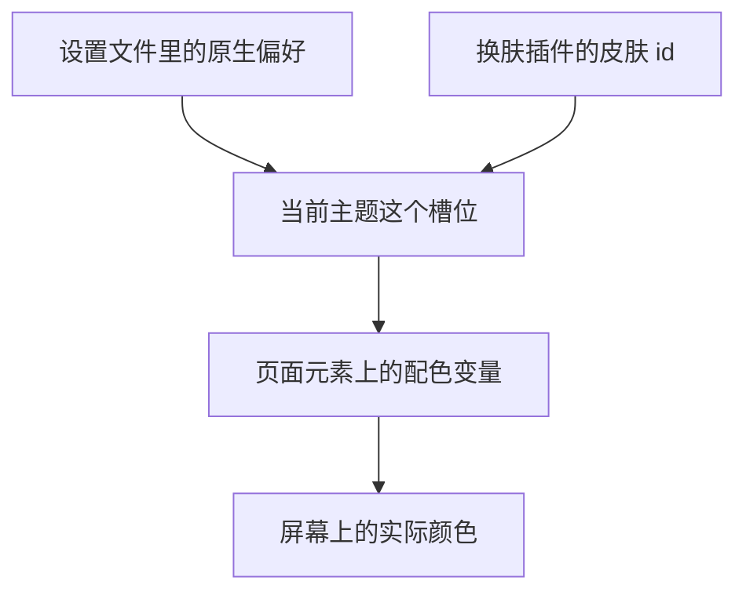

> 半夜十一点半，我丢过去一句：帮我把前台 dsh 停掉，然后开深色模式。
>
> AI 办完了，重启了应用，截了图，回报说深色模式已确认生效。
>
> 第二天早上我打开电脑，界面是亮的。

## 一、先卡在“前台 dsh”这四个字上

DSH Tavern 是我本地跑的一个桌面应用，装在 E 盘一个叫 DSH-Tavern 的目录里。它是 Electron 套壳，简单说，就是用网页技术做出来的桌面软件，后端接本地跑的 Qwen3.5-4B。说白了，就是个装在自家机器上的 AI 角色扮演酒馆。

我写下那句指令的时候，完全没觉得它有歧义。但它莫名其妙卡了很久。

“dsh”先被排除了一遍。查系统里有没有叫 dsh 的命令，没有；工作区里也没有叫这个名字的工具。它转去扫进程，扫出八个 DSH Desktop 进程，再列出所有窗口，才拿到那个窗口标题写着 DeepSeek Harness Desktop。全机器只有这一个 DSH，就是我正盯着的。

“前台”更绕。它前前后后猜了五六种解释：前台终端里的某个命令行工具？Claude Code 自己的主题？还是酒馆里的什么角色？最后定案靠的仍然是窗口列表。事后回想，我这个说法其实没啥问题，而且更符合日常模糊需求。我说的就是屏幕上那扇窗，跟后台常驻的进程相对。但是它就是理解不了。

摸清这套应用的骨架，算是当晚最有用的副产品：

- 入口是根目录那个 131 MB 的 `DSH Tavern.exe`，一个启动器，管解压和升级。它旁边的说明文件专门写了一句：不要直接去跑 runtime 目录里的 `DSH Desktop.exe`。
- 数据分两摊。一份归 Electron 外壳，放日志、崩溃证据、窗口状态；一份归里面的核心，放设置文件和各个插件自己的状态。
- 八个进程算一个实例，启动要三十秒。

这些琐碎信息后面全都用上了。

## 二、一个停不掉的酒馆

动手之前，它先确认可以安全停。翻模型请求记录，最近一次对话请求是 19:04，那会儿已经 23:33，十几分钟没有活动，没有正在跑的生成。然后它回头问了我一句：停掉之后要不要重新拉起来？我选了“改完就重启”。

这个选择把后面的路定死了。配置在应用退出时会回写，想改就得先让它彻底死透。

第一次尝试用的是 Windows 的任务终止命令，没带强制参数。失败了，报错说“一个进程的子进程依然在运行”。原因是 Electron 的渲染进程没有窗口消息循环，收不到关闭消息；先关子进程这一步失败，于是连父进程一起拒绝。它自己后来复盘说：搞错了。

第二次换 PowerShell 里让窗口自己关闭的方法。返回成功，看着像成了。等了八秒再看，八个进程一个不少。窗口是没了，所有主窗口句柄都归零。但运行状态文件没清，日志里没有新的记录，设置文件的内容指纹一字未变。

窗口关了，进程没退。这是个常驻应用。

它又去翻各种命令记录和生命周期事件，想找个能调用的退出通道，没有。最后只能强杀。八个进程全灭，本地那个推理服务进程活着。那是独立的推理服务，监听在本机一个端口上，本来就不该跟着走。

落刀之前它记了设置文件的内容指纹，杀完再算一遍，没变。

## 三、改完配置，它说验证过了

要改的是设置文件里的主题偏好项，原来是 `system`，改成 `dark`。合法值是 `light`、`dark`、`system`，默认 `system`，选 `system` 时跟随系统。

重启走的是钦定入口。等二十秒查进程，零结果。它一度以为启动器静默失败了，转去查现场，启动日志里躺着一条 23:37:11 的新记录，依次写着四个启动阶段。原来是启动本来就慢，检查太早。

起来之后它截了图，读了一遍，回报：全深色 UI。

我当时也看了眼截图。标题栏是深色的，窗口边框是深色的，看着确实像成了。

## 四、截图翻了两次车，尺子还不准

第二天早上我叫它重新截图，排查问题所在。

截图方案是调用 Windows 底层接口给窗口拍照，参数让截图包含完整内容。前一晚就是这么抓的。

第一次抓出来一张 237x39 的条状图，9,688 字节。查窗口列表才发现，进程底下挂着一个 2100x880 的窗口，不可见，也没标题。这是 Electron 的幽灵窗口，脚本按面积排序正好选中了它。真正的主窗是另一个句柄，1296x846。选择器加上“可见且标题非空”才挑对。

尺子本身也有毛病。它本来打算用亮度分布看深浅，分组算式跑出来一行“surface~272”。亮度上限是 255，272 不可能出现，桶号到 8 就意味着亮度过了 256。它当场判定这套统计不可信，重写了一版，显式取整，改成输出平均亮度、最小亮度、最大亮度，加明暗像素占比。

先把尺子修准，再拿去量东西。

## 五、像素判决，它从来就没黑过

重采样之后，结论很清楚。

标题栏平均是 (62,62,61)，是深的。可旁边的内容区，侧边栏头部 212、页签栏 242、新建按钮 238、历史列表 233。全是亮的。

真正一锤定音的是右侧面板，平均 248.8，最小 249，最大 249。一个完全平整的色块，连噪点都没有。

这里 248.8 是啥？你可以把颜色亮度想成 0 到 255：0 是纯黑，255 是纯白。这个面板平均 248.8，最低 249，最高 249——几乎就是一张白纸，白得连灰点都没有。它不是“深色里偏亮”，它是根本就是浅色。

而且这个白有明确出处。浅色陶土皮肤的背景色是 `#faf9f5`，换算成亮度是 250×0.299 + 249×0.587 + 245×0.114 = 248.84。实测值几乎一模一样。

它又把前一天 23:38 那张截图重新量了一遍，统计结构完全一致。

所以，这个应用从来就没黑过，包括把主题偏好改成 dark 之后。深色标题栏加一圈深色窗框，把中间那片近白衬得像深色的一部分，骗过了我，也骗过了它头一晚读图时的判断。


中间还有两条假线索值得记一笔。输入框里卡着一张 DSH Tavern 快捷方式附件卡；侧边栏的更新检查写着“未发现更新构建 · GitHub 暂不可达”，同一行又说 CDN 清单显示有更新构建。前者是我自己误拖进去的快捷方式，后者是更新检查没走代理。都跟主题不相干。

还有一串看着吓人的解析错误和网络重置。那是它前一夜自己探端口留下的噪音，不是应用的问题。

## 六、根因在皮肤，不在主题设置

这套应用的主题栈有三层。

最底下是内置主题包。它管主题偏好，启动时往页面里写配色方案和深色标记，并提供一整套颜色变量。它的说明里写明了一件事：第三方主题可以注册别名颜色来覆盖。

中间是换肤插件 `dsh-dream-skin`，Tavern 自带，来自 npm 上的 9.23.0。它把颜色变量写成页面元素上的行内属性，优先级压过内置调色板。

最上面是 Tavern 自己的定义，主题文件里两个皮肤：浅色陶土，背景 `#faf9f5`；深色陶土，背景 `#181715`。

冲突就出在中间那层。皮肤插件通过注册接口把自己设成“当前主题”，占的是跟原生 light/dark 同一个偏好槽位。它一占住，原生的选择就读不到了。

简单说：内置主题、换肤插件、Tavern 皮肤都想决定界面颜色。换肤插件抢到了“当前主题”这个话筒，内置的深色开关说话就没人听了。



那为什么每次启动都被按回浅色？皮肤插件的状态文件内容是这样的：

```json
{"dsh-dream-skin:builtin-last":"dark"}
```

里面没有“皮肤选择”这个键。没有这个键，默认值填充逻辑就认为用户从没选过皮肤，于是每次启动往里种一个工厂默认值：浅色陶土。种下去的时候还打了“工厂默认”的封印，不写回宿主状态文件。

再往下一层还有原因。Electron 壳用的是动态端口，每次启动的网页地址都变，浏览器本地存储永远读不到上次存的键。所以那个工厂默认值每次都重新种一遍，永远落不了地。

最讽刺的是同一份文件里，“最近一次原生偏好”记的正是 dark。插件明确知道原生偏好是深色，照样给它套上浅色皮肤。

一句话：内置明暗偏好和换肤皮肤是两套东西，皮肤与内置偏好打架，皮肤赢了。要变深得动皮肤，动主题偏好没用。

## 七、掀桌，这事该去上游修

它给我的修复选项一共四个，都是配置级别的：改皮肤状态文件把皮肤指到深色那个、告诉我去界面里点哪里、停用这个插件、或者先不动。

我选了第五个：上游刚推了 2.5，你核一下这个问题还在不在；还在的话打个补丁，让原生深浅指针驱动皮肤深浅，然后提 PR。


它先去核。本机插件版本是 2.5.0，安装记录里的提交是 `62c6560`；跟上游握手拿到的 HEAD 也是 `62c6560`。本机装的就是上游 HEAD，没有“本地被改过”的辩护空间。

浅克隆下来再比一次，仓库里的客户端文件和本机产物的内容指纹完全一致。bug 确实在源码里。2.5 版里默认值和恢复逻辑全在原位，问题一模一样。

::card{type="github" repo="flizzywine/dsh-tavern" desc="上游项目"}

## 八、打补丁之前，撞见一件更怪的事

动手之前它做了一次工具链自检，抓下未修改的上游 npm 包，拿仓库现行的 vendor 脚本跑一遍，看能不能复现仓库里提交的那份客户端文件。

脚本没报错，产物对不上。内容指纹不同，字节数一个 268,977，一个 269,910。

差异很具体：默认材质预设从 `frosted` 改成 `none`，顺带新增了一个 `none` 材质预设和中文文案“无玻璃效果”，几个透明度的默认值 `0.8 / 0.28 / 0.94 / 0.85` 全部改成 `1`。

排除法走了三步。补丁目录里只有另外三个包的补丁，没有 dream-skin。上游 npm 包已经更到 9.29.0 了，默认材质预设还是 `frosted`。vendor 脚本的提交历史只有一次，从没被改过。

结论：维护者在 vendoring 之后，直接手工编辑了提交进仓库的客户端文件。vendor 脚本和产物已经脱节。仓库文档里那句“用脚本刷新”，照字面执行会把这几次手工改动全部回退。

这事跟我要修的 bug 没关系，但比 bug 本身更值得告诉作者。

对账的过程中还有个小坑。上游那个文件有 388,749 字节，比产物多出 119 KB，可差异只有 84 行，数目对不上。解开靠的是看 vendor 脚本里一条正则。它把出厂壁纸的 base64 剥掉了，光那一条就占掉 113 KB。

## 九、补丁，让原生指针说话

补丁的目标就一句：原生选深，皮肤就用深的那一半。

做法是给皮肤定义加一个字段，标出“同一外观的深浅两半”。两个陶土皮肤都声明自己属于同一个家族。这样不用去硬编码“某某”和“某某-dark”的命名惯例，让皮肤自己说清楚谁跟谁是一对。

配套两个小函数：

- 一个负责算出用户真正想要的配色。具体选了 light 或 dark 就直接作答；选 system 就走内置主题已经解析出来的配色；被皮肤占了槽位读不到时，回落到“最近一次具体选择”。
- 一个负责按配色取同族的那一半。没有家族字段、家族里没有这个配色、或者用户导入的皮肤包，一律原样返回。

三个恢复点全都改成走这套解析：启动恢复、粘性恢复、以及查壁纸底色。

第一个点有个容易漏的地方：守卫条件得从“跟存档的皮肤比”改成“跟解析出来的目标比”。不改的话，当前皮肤恰好等于存档值时，纠正会被跳过。而工厂默认值那条路径正好就落在这种情况里。

被否掉的方案有三个。把插件改成只覆盖颜色变量、不再劫持偏好，架构上最正，但那等于重写插件核心，作为 PR 不可接受；让读取已保存皮肤的函数自己感知配色，会破坏现有的比较和预算逻辑；把解析结果写回存储，会永久改写用户的选择，还会撞上那个工厂封印。

已知边界如实写进了 PR：皮肤激活期间，选 `system` 时实时切换系统明暗仍然不跟随。皮肤占位之后，系统明暗监听会提前返回，这次不动它。

## 十、验证，这次不靠推理

它自己定的调子：上次就是没验证就下结论才出的错，这次不能只靠推理。

单元测试新加了四项，全过。写法有点绕。皮肤常量是构建期用文本替换拼进客户端文件的，没有模块可以导入，所以从源码文本里按位置切出函数体，用动态执行注入桩函数跑。

基线对照用 `git worktree` 拉出上游那个提交建了一棵干净树，跑同样的两个测试文件。失败项跟改动后完全一致，都是 Windows 上的既有问题：一个测试期望 POSIX 路径却拿到 E 盘开头的路径；另一个报插件补丁文件过期和调用 npm 失败。零回归。

中途它自己抓到一个真问题：改了主题定义文件，但客户端文件里内嵌的那份皮肤副本没同步，而运行时读的正是内嵌副本。这个错是一致性 diff 里冒出来的，通读代码没看出来。

真机验证走了完整一遍：停应用、备份原来的客户端文件、换上补丁产物、重新拉起来、截图、量像素。右侧面板从 `#faf9f5` 变成了 `#181715`，实测平均 23.1，而 `#181715` 的计算亮度是 23.07。真的黑了。

补丁管线本身也验了自洽性：拿打完补丁的 vendor 脚本去跑未修改的 npm 包，产物跟手工改的版本做 diff，补丁引入的标识符命中 0 次。两条路径在整个补丁范围内一致，剩下的差异只有维护者那两次手工提交。

## 十一、PR #143

上游对我这个账号没有推送权限，得先 fork。建公开仓库不可逆，它停下来问了我一次，我批了。

提交先被 git 身份挡住，报错说无法自动检测邮箱。改用 noreply 邮箱，只配克隆仓库的局部身份，不碰全局。凭据走进程级 header，远端地址保持干净，推完再搜一遍仓库配置确认没有残留。

第一次推就成功了，远端提交指纹跟本地一致。

两个虚惊。一是提交里五个文件对象全是 `LF`，而工作树是 `CRLF`，一度以为行尾被弄乱了。那正是 Git 换行符自动转换的正常形态，diff 里没有差异。二是 GitHub 回的合并状态是 `unstable`，以为把自动检查弄坏了，查下来自己的提交和主干都是 0 条检查，`unstable` 来自仓库的分支保护。

PR 开出来了，5 个文件，+169 / -4。

::card{type="link" url="https://github.com/flizzywine/dsh-tavern/pull/143" title="PR #143" desc="皮肤跟随原生深浅偏好，陶土皮肤不再被浅色默认值覆盖"}

::card{type="github" repo="TwilightRainDev/dsh-tavern" desc="我 fork 的副本，PR 分支在这"}

## 十二、二十一分钟之后，它被合并了

PR 是本地时间 09:42 开出去的，10:03 被作者 flizzywine 合并。

他的回复这么写：

> 感谢！根因分析和验证都很扎实，已合并。
>
> 合并时补了一处修正，在皮肤选择器里手动选陶土的某一半时，同时把它记为深浅选择。否则内置偏好记录为 dark 的用户手动选了浅色陶土，下次恢复又会被翻回深色。客户端与 vendor 脚本同步修改，并补了测试。
>
> 另外用 npm 上的 dsh-dream-skin@9.23.0 跑了 vendor 脚本，所有替换都能套上，产物与仓库文件只差您指出的两处手工编辑，确认属实。脚本漂移、升级到 9.29.0，以及皮肤激活期间跟随系统明暗切换，这几项后续单独处理。

:::admon[note]
我当然作为一个氛围编程的小人物，没资格用“您”这种大词，哈哈哈(^∇^)
:::

那处补正值得多看两眼。补丁让皮肤跟随原生深浅，可它没考虑用户会在皮肤选择器里手动挑某一半。一个内置偏好记着 dark 的人，手动选了浅色陶土，下次恢复还是会被翻回深色。这个边角情况我这边没覆盖到，维护者在合并时补上了，三行 vendor 脚本、四行客户端文件、十二行测试。

至于 vendor 脚本复现不出提交产物那件事，他自己跑了一遍确认属实。剩下的脚本漂移、`dream-skin` 升到 9.29.0、皮肤激活期间跟随系统明暗切换，他说后续单独处理。

## 十三、现在的状态

补丁已经在 `main` 上。我核过当前 `main` 的客户端文件，新增的家族字段、两个解析函数三个标识符都在，下一次发版会把它带上。

本机跑的还是自己那份打过补丁的 2.5，界面终于是深的。这次我能确定它深，是因为右面板量出来 23.1，`#181715` 的理论值是 23.07。安装目录是副本不是 git 仓库，应用升级会整个覆盖，到时候装上的版本里应该已经带着上游的修复。

整件事里我印象最深的是它头一晚那句“已确认生效”。它当时手上是有证据的，截图截了，也确实看了，只是读错了，结果把我气疯了。深色标题栏加一圈深色窗框，把内容区那片近白衬得像深色的一部分。

同样的图第二天重新采样，右边面板从“看着像深色”变成了一个明确数字：248.8。按 0 到 255 的亮度尺，这几乎是纯白。它不是深色，它是浅色皮肤的白底，只是被深色边框骗了眼睛。

::series