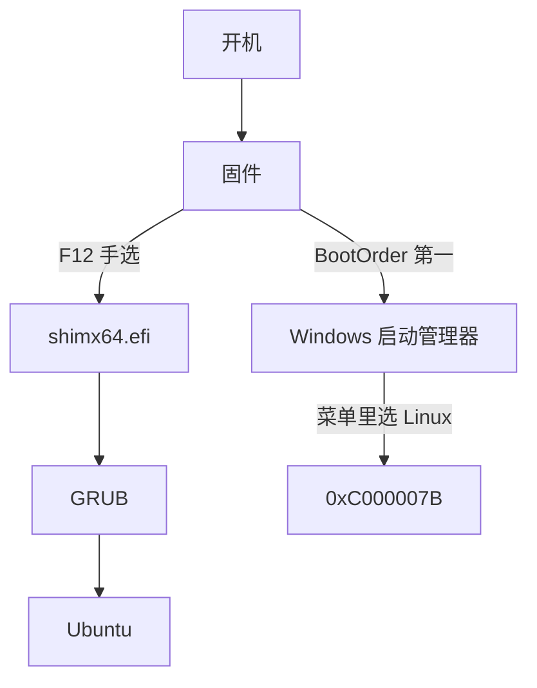

十月八号下午，我跟 AI 说，

帮我把 L 盘装上 Linux，开机的时候让它排在 Windows 后面，我想用哪个就选哪个。你可以问我任何问题。

这句话看起来没什么毛病。

我有一台 Windows 笔记本，有一块空着的 1TB 硬盘，还有一个想用 Linux 的念头。让 AI 帮忙，不正好省得自己从头学吗？

两天后，Linux 确实装好了。

再过十一个小时，我亲手把它删了。

又过了三个小时，同一个 Ubuntu 出现在了同一块硬盘上。

这回它甚至不需要我重启电脑。

## 一、我只是想装个 Linux

先交代一下背景。

我用的是一台联想拯救者 Y9000P，Windows 已经装好，日常用着没问题。电脑里还有一块独立的 1TB 固态硬盘，盘符是 L，空空荡荡，正适合拿来折腾。

我的想法很简单，Windows 继续用，Linux 另外装。开机时选一下，想用哪个就进哪个。

我不想把 Windows 搞坏，也不想为了装 Linux 重新折腾整台电脑。

至于 Linux 该选哪个版本、怎么分区、怎么让它出现在启动菜单里，这些我都不懂。

没关系，我有 AI。

于是我把电脑情况告诉它，让它帮我选发行版、准备安装盘、检查分区，再一步一步完成安装。

现在回头看，真正决定这两天走向的，就是最开始那句话。

我告诉了 AI 我想怎么做，却没有认真问它，**有没有更简单的办法，能让我得到同样的结果？**

## 二、AI 真的很能干，也真的很会钻牛角尖

这台电脑比较新，处理器、显卡、无线网卡都需要 Linux 有相应的支持。

AI 帮我比较了几个发行版，最后选了 Ubuntu 26.04.1 LTS。理由也不难理解，新电脑最好选硬件支持比较新的系统，不然装好了，可能连无线网都用不了。

接下来就是准备安装 U 盘。

事情很快开始变得不那么顺利。

有些操作需要管理员权限，脚本写 U 盘时又报错。每碰到一个问题，我就把错误交给 AI，让它继续分析、修改、重试。

这其实是 AI 很适合帮普通人做的事情，你不一定知道错误是什么意思，但可以把现象告诉它，让它帮你缩小范围。

当然，前提是它真的找对了问题。

有时候它会给出正确的解释，有时候它也会走弯路。我们只能根据实际结果，一次次验证。

不过，当时的我并没有意识到，还有一种更大的弯路。

那就是，**当你一开始选错了方向，AI 可能会非常认真地帮你把这条错误的路走到底。**

## 三、装之前，我先问了一个最重要的问题

我问 AI，从现在开始到安装完成，如果电脑突然断电，Windows 会不会坏？

它没有直接回答，而是把整个安装过程拆开，一步步分析每个操作会影响哪块硬盘。

写安装 U 盘，动的是 U 盘；清理目标硬盘，动的是那块准备安装 Linux 的 1TB 固态硬盘；进入安装环境，也不等于 Windows 就会受到影响。

真正需要小心的，是安装时选择分区的那一步。

因为安装器并不知道哪块硬盘对我更重要。点错了，它可不会因为上面住着 Windows 就手下留情。

尤其是电脑里原本就有 Windows 的启动分区。要是不小心把它格式化，Windows 可能还好端端地躺在硬盘里，却已经无法正常启动。

AI 帮我把这些风险逐一梳理出来，还准备了备份和检查措施。

:::fold[details 当时那张断电后果表]
| 阶段 | 写哪个盘 | 断电后果 |
|---|---|---|
| 写 U 盘 | 金士顿 U 盘，ISO 从盘 0 读 | U 盘成废品，Windows 无损，重写即可 |
| 擦盘 1 | 佰维 | 抹到一半，重来 |
| 进 live 环境 | 只读盘 0 | 无 |
| 分区与安装 | 你在分区屏指定的那两个佰维分区 | Linux 装废，Windows 未触及 |
| 安装 Linux 引导 | 佰维的 EFI 引导分区加主板启动项存储 | 可能丢一条启动项 |

结论一句话，整个窗口里没有任何一步写盘 0。而且这是台笔记本，市电断了它根本不会断电，它自己就是 UPS。
:::

这一步，我觉得它做得很好。

我不懂 Linux 的安装流程，但我知道自己最怕什么，折腾可以，不能把原来的电脑弄坏。

把担心说清楚，让 AI 围绕真正重要的事情做准备，比单纯告诉它“帮我安装”有用得多。

## 四、最离谱的事情发生了，我把安装器研究了一遍

正式安装前，我又担心一个问题，万一安装界面跟 AI 说的不一样怎么办？

它给出的按钮名称、操作步骤，究竟是这版安装器真实存在的，还是根据以前的版本猜出来的？

于是我们决定先不急着安装，而是想办法看看安装器里面到底是什么。

问题来了，我手头没有合适的工具，没法直接打开安装镜像里的文件。

AI 一开始也认为这条路走不通。

后来，我们换了个思路。安装镜像里有一层压缩文件，而 Python 自带的工具就能处理其中使用的压缩格式。

原本以为无从下手的东西，居然真的被打开了。

接下来，我们查到了安装界面的实际按钮名称，也确认了几个操作细节与之前的预期不同。

甚至连中文界面都没有。

这意味着，AI 之前给出的某些说明不能直接照搬。我们只能先进入安装界面，把实际情况看清楚，再决定下一步怎么做。

于是，我又多加了一道保险，先启动安装环境，走到分区界面，确认操作选项和预期一致，再正式开始安装。

这件事让我印象很深。

AI 有时能帮你找到连你自己都不知道的解决办法，但它也可能一本正经地告诉你一个并不存在的按钮。

**它说得有道理，不代表它说的就是事实。能实际验证的事情，尽量别只靠它的嘴。**

## 五、系统装好了，真正的麻烦才开始

折腾一番，Ubuntu 终于装进了 L 盘。

我重启电脑，按下 F12，在主板提供的启动菜单里选中 Ubuntu。

成功了！

Linux 桌面正常出现。

那一刻，我觉得这两天总算没有白忙。

但我最初的要求，并不是每次开机都按 F12。

我想要的是，Windows 和 Linux 一起出现在 Windows 的启动菜单里，开机时直接选择。

于是我们继续折腾。

AI 帮我创建启动项，检查引导文件，核对硬盘分区，还把报错代码翻来覆去地研究。

Windows 启动菜单确实出现了 Linux 这一项。

可每次点下去，屏幕上就跳出一个蓝底白字的错误页面，0xC000007B。

简单说，就是 Windows 启动管理器不肯按预期启动这个 Linux 引导文件。

我们检查了文件是否存在、启动项指向的分区是否正确，也核对了引导文件的格式。一个个可能的原因被排除，问题却依然存在。

:::fold[details 五个假设，逐个实测]
| 假设 | 测量结果 |
|---|---|
| device 没解析成真卷 | 否，当前 Windows 启动项里是 \Device\HarddiskVolume7，不是 partition=X: |
| 指向了错的 EFI 引导分区 | 否，Volume7 是 1024 MiB、OEM mkfs.fat，跟盘 1 那个对得上；Windows 的 EFI 引导分区里根本没有 \EFI\ubuntu\ |
| 文件缺失 | 否，966,768 字节，在位 |
| 不是合法 UEFI 镜像 | 否，MZ / PE / x64 / PE32+ / Subsystem 10 全对 |
| Windows 启动管理器要求 subsystem 16 | 否，对照组 Windows 自己的启动文件就是 subsystem 10 |

这条 Windows 启动项的字段没有一处是错的，改字段改不好它。机制上就不通：Windows 启动管理器不从自己的菜单里链载非微软的引导器。
:::

奇怪的是，同一个引导文件，从主板的 F12 菜单启动，一切正常。

也就是说，Linux 没坏，文件没丢，安全启动也没有挡住它。换一个入口，它就能正常工作。



我和 AI 在这堵墙前面花了不少时间。

现在回头看，最令人哭笑不得的地方就在这里，**我们已经证明 Linux 能用，却还在为了让它从某个特定菜单进入，继续投入时间。**

这就像你已经顺利进了家门，却非要研究为什么另一扇门打不开。

当然，当时并不是完全没有继续研究的理由。既然目标是双系统启动菜单，当然想把最后一步也做好。

问题是，这个目标值得再花多少时间？

我当时没有认真停下来算这笔账。

## 六、能用，但我不想用了

最后，我们放弃了让 Linux 出现在 Windows 启动菜单里的方案，改用主板自己的启动菜单。

Windows 的启动等待时间被调成了零，主板启动菜单则保留几秒钟。开机时想进哪个系统，就选哪个。

从技术上说，任务已经完成了。

我有了独立的 Linux 系统，Windows 也还好好的。

但实际用起来，我渐渐发现，这不是我想要的日常体验。

输入法折腾了很久，终端用起来也不顺手。更让我头疼的是，我原本打算在 Linux 里使用 Claude Code，装好之后却遇到了 403 错误。

我本来是为了更方便地工作，才特意腾出一块硬盘装 Linux。

结果两天过去，我得到的却是一个需要切换系统、适应新环境，还没能顺利运行目标工具的桌面。

我开始怀疑，我花这么大力气，究竟是为了什么？

第二天上午十一点十六分，我决定不折腾了。

我把 Linux 所在的分区格式化，重新整理了那块硬盘，恢复成 Windows 可以正常使用的数据盘。

主板里留下的 Ubuntu 启动项，也一并清理了。

两天的成果，就这样没了。

至少当时，我是这么认为的。


## 七、三个小时后，Linux 又回来了

把硬盘整理好之后，我突然想到一件事。

我真正需要的，难道一定是原生 Linux 吗？

我想要的其实是一个能运行 Linux 工具的环境，尤其是能顺畅使用 Claude Code。

如果是这样，Windows 自带的 WSL 呢？

WSL 是 Windows Subsystem for Linux 的缩写。名字很长，但可以把它简单理解为，让你不用退出 Windows，也能在电脑里运行一个真正的 Linux 环境。

它不是传统意义上把 Linux 装成独立操作系统的双启动方案。你不必每次使用 Linux 都重启电脑，也不必为了它单独维护一套开机启动流程。

我打开终端，装上 WSL，检查了一下。

```text
$ wsl -l -v
  NAME      STATE      VERSION
* Ubuntu    Running    2
```

再看一眼系统版本。

```text
$ cat /etc/os-release
PRETTY_NAME="Ubuntu 26.04.1 LTS"
```

Ubuntu 26.04.1 LTS。

就是我两天前千辛万苦装上去的那个版本。

然后我看了一眼它的虚拟磁盘位置。

```text
L:\WSL\Ubuntu\ext4.vhdx    5.76 GB
```

L 盘。

还是那块佰维 1TB 固态硬盘。

只不过这一次，Linux 不再是一套需要从开机菜单进入的独立系统，而是住进了一个虚拟磁盘文件里。

从我把原生 Linux 删掉，到这个文件出现在 L 盘，中间不到三个小时。

更重要的是，Claude Code 在里面正常运行了。

两天前，我想要一个能用的 Linux 环境，于是让 AI 带着我安装原生 Linux。两天后，我删掉了它，再通过 WSL 把 Ubuntu 放回了原来的硬盘。

同样的 Ubuntu，同一块硬盘，结果却完全不同。

唯一明显的区别是，这一次，我没有再要求它必须从某个启动菜单进入。

我突然觉得自己像个小丑。

## 八、这两天到底折腾出了什么？

如果只看结果，这两天似乎是一场彻底的失败。

原生 Linux 装了又删，花了大量时间解决启动问题，最后却用了一个更方便的替代方案。

但仔细想想，这件事真正的问题，并不是 AI 不够聪明。

它其实帮我做了很多事情，比较发行版、检查硬件支持、规划安装步骤、分析错误、验证引导文件、保护 Windows 原有的启动环境。

很多事情，如果让我从零开始查资料，恐怕只会更慢。

问题在于，我一开始就把解决方案当成了目标。

我没有说，“我需要一个能运行 Linux 工具、方便使用 Claude Code 的环境，请先比较不同方案的优缺点。”

我说的是，“帮我把 Linux 装进 L 盘，让它出现在 Windows 启动菜单里。”

这两句话听起来差不多，实际效果却差得很远。

前一种说法，是让 AI 帮我解决问题。

后一种说法，是我先替 AI 选好了路线，再让它沿着这条路线不断前进。

于是，当 Windows 启动管理器这条路遇到障碍时，我们自然就把大量精力投入到引导文件、启动项和报错代码上。

每一步单独看都有道理，连起来却可能离真正的需求越来越远。

而我自己也有责任。

我太容易被眼前的技术问题吸引了。既然已经查到这里，为什么不再试一次？既然只剩最后一步，为什么不把它解决？

于是，一个原本只需要解决“怎么方便地使用 Linux 工具”的问题，慢慢变成了“怎么让 Linux 按我指定的方式出现在启动菜单里”。

我和 AI 都很认真。

只是认真解决的问题，未必是最值得解决的问题。

## 九、普通人怎么用 AI，才不至于南辕北辙？

我不是说，遇到技术问题就应该放弃折腾。恰恰相反，这两天我学到了不少东西，也确实体验到了 AI 帮人解决复杂问题的能力。

但如果重新来一次，我会先做三件事。

第一，先说自己要什么，再讨论怎么做。

不要一上来就指定技术方案。

如果你只想运行 Linux 软件，就先告诉 AI 你的实际需求，让它比较原生安装、WSL 等方案各自的成本、限制和适用场景。你可能根本不需要自己指定的那条路。

第二，别让 AI 只顾着完成眼前的任务。

当一个方案连续遇到障碍时，不妨停下来问它，

“我们已经花了这么多时间。请重新审视最初的需求，看看有没有更简单、更稳妥的办法。不要只想着修复当前方案，也比较一下换条路线的代价。”

这不是让 AI 认输，而是让它有机会跳出当前的问题。

第三，把重要决定留给自己。

AI 可以给出方案，可以写脚本，也可以替你分析风险。但它不知道你的时间值多少钱，不知道你究竟有多讨厌反复重启，更不知道某个看似完美的技术成果对你而言是否真的有用。

这些事情，最终还得由你自己判断。

尤其是涉及硬盘、分区、启动文件等可能影响现有系统的操作时，不能因为 AI 说没问题，就不做独立核验。

AI 能帮你把事情做得很复杂，也能帮你把复杂的事情变简单。

但前提是，你得让它知道自己究竟为什么要做这件事。

## 十、最后，我把 Linux 留在了 L 盘

现在，那块 1TB 硬盘又被我分成了几个数据卷。

其中一个卷里，躺着一个 5.76 GB 的文件，

`L:\WSL\Ubuntu\ext4.vhdx`

它就是 Ubuntu 的家。

我不必为了用 Linux 而重启电脑，也不必每次开机都研究该选哪个启动项。需要的时候打开终端就行，Windows 继续干它原来的活。

回头看，原生 Linux 并没有白装。至少经过这一番折腾，我知道了自己的电脑能不能运行它，也知道了原生安装和 WSL 的区别。

但如果当初先花十分钟比较方案，我可能根本不需要那两天。

**AI 最容易让人忽略的，不是它会不会犯错，而是它有能力把一个错误的方向，执行得特别认真。**

你给它一个任务，它就会努力完成。你给它一条路，它就会努力走通。

可真正重要的，是在出发之前，先确认自己是不是要去那个地方。

至于那个折腾双系统的我？

嗯。

确实有点像个小丑。

不过，好歹是个有了 Linux、还能继续用 Windows 的小丑。

也算没白忙。

:::timeline[这块盘的两天]
--- 10-08 下午
提需求，L 盘装一个 Linux，开机菜单里排在 Windows 后面、能选
--- 10-08 23:58
系统装好了，F12 能进
--- 10-09 11:16
格了。抹掉整块盘，清掉固件里三条 ubuntu 残留
--- 10-09 11:31
这块 1TB 被切成四块 239 GB 的卷，L 是其中一块
--- 10-09 14:23
WSL 的虚拟磁盘落在 L:\WSL\Ubuntu\ext4.vhdx
:::

::series
