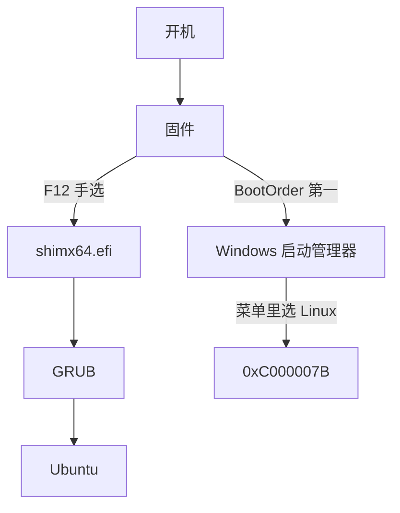

> 十月八号下午，我丢过去一句，帮我把 L 盘做一个能在开机菜单里排在 Windows 后面、可以选着启动的 Linux 系统，你可以问我任意问题。
>
> 这句话有两半。“装一个能用的 Linux”做到了。“排在 Windows 之后、开机可选”，两天之后证明，做不到。
>
> 而那个装好的 Linux，十一个小时后就没了。

## 一、先交代这台机器

Legion Y9000P。Core Ultra 9 275HX，31.4 GB 内存，RTX 5060 Laptop 加一块 Intel 核显、一个 NPU，无线网卡只有一张。

盘 0 是长江存储那块，Windows 住在上面，一个 300 MiB 的 EFI 引导分区、一个微软保留分区，剩下切成 C、D、E、G 四个盘符。盘 1 是佰维 1TB，也就是 L 盘，整块空着，只有开头有一个微软保留分区，剩下 99.998% 都没分配。

需求挺直白，Linux 装进盘 1，开机菜单里排在 Windows 后面，想用哪个选哪个。

## 二、选发行版，其实是内核版本问题

这台机器太新，是 2025 年之后才有的。内核认不出来，就是没声音、没网、没显卡，装上也等于砖头。

所以候选其实只剩一个，Ubuntu 26.04.1 LTS，内核 7.0，仓库里就是对应的 NVIDIA 驱动。Linux Mint 官网当时的稳定版是 22.3，底层还停在 Ubuntu 24.04，内核落后一档，等于要自己满世界找驱动。

安全启动保持不变，开着。代价是 NVIDIA 闭源驱动要走一次 MOK 登记，也就是给安全启动登记驱动签名。

## 三、卡在最没技术含量的一关

第一块铁板跟 Linux、跟分区、跟显卡都没关系。

它不是管理员。

Windows 启动配置编辑命令 bcdedit 回了六个字，无法打开引导配置数据存储。拒绝访问。这台机器上凡是碰引导、碰磁盘的操作全要提权，后面每件正经事的开头都得先弹一个管理员授权窗口。

写 U 盘那步也不顺，脚本连着挂了几次，报错是往 U 盘裸设备写的时候抛出“函数不正确”。

## 四、装之前，先把退路铺好

我问了一个问题，从现在到装完，任意一个时刻突然断电，Windows 有没有可能坏？

它没直接答，先列了张表，把每一步写哪个盘、断电什么后果全摊开，

| 阶段 | 写哪个盘 | 断电后果 |
|---|---|---|
| 写 U 盘 | 金士顿 U 盘，ISO 从盘 0 读 | U 盘成废品，Windows 无损，重写即可 |
| 擦盘 1 | 佰维 | 抹到一半，重来 |
| 进 live 环境 | 只读盘 0 | 无 |
| 分区与安装 | 你在分区屏指定的那两个佰维分区 | Linux 装废，Windows 未触及 |
| 安装 Linux 引导 | 佰维的 EFI 引导分区加主板启动项存储 | 可能丢一条启动项 |

结论一句话，整个窗口里没有任何一步写盘 0。

它接着把这个问题本身推翻了。这是台笔记本，市电断了它根本不会断电，它自己就是 UPS。所以“要不要另外挑个稳定的场合”是个伪问题，真问题是有没有插电。它顺手读了一眼，没插电，放电 28,996 mW，剩 14,120 mWh，按当时的功耗算不到半小时。

真正能毁掉 Windows 的不是电，是分区屏上多点一个 Format。

给那个 300 MiB 的 Windows EFI 引导分区勾上 Format，Windows 的启动文件就没了，Windows 立刻起不来，得拿安装 U 盘跑 bcdboot 才救得回来。它给的防线是一句口诀，装完回头数自己勾了几个 Format，正确答案是有且只有 1 个。

另外铺了两条退路。EFI 引导分区只读备份的脚本里塞了四道护栏，目标真的是 EFI 系统分区、只有它带着 Windows 启动文件、容量对得上那 300 MiB、目标盘有空间，设计目标是“一个字节都不写 EFI 引导分区”。擦盘脚本的护栏是，盘号不能是 0、不能是启动盘或系统盘、型号要匹配、容量落在 950 到 960 GiB 之间。

## 五、填上一个已经被判死刑的洞

装之前得先知道安装器长什么样。这里卡在上一轮的结论上，本机没有任何能读 Linux 安装镜像里压缩文件系统的工具，7z 没有，unsquashfs 没有，Python 也没有 zstandard。上一轮给这个洞判了死刑。

工具层面是实话，结论错了。那个压缩文件系统外层用的是 xz，而 Python 标准库自带 lzma。

洞填上之后，安装器整个被掀开，顺手推翻了官方安装指南两处。一处是整节作废，指南里有一节讲 MOK 登记，描述首次重启会出现的蓝底白字界面，而安装器二进制里 MOK、mokutil、secure boot key 各出现 0 次，两种大小写都搜过，那个界面在这版安装器里不存在。另一处是按钮名全照旧版猜的，实测对话框标题是 Edit partition，不是 Change；标签是 Used as，不是 Use as；而且根本没有 Format 勾选框。

顺带查出一条，中文界面不存在。搜“分区”“磁盘”“格式化”“安装”全是 0 次，本地化文件列表里也没有中文。

于是多了个环节，写完 U 盘、擦完盘 1 之后，先启动一次走到分区屏，不点 Install，拿实测标签跟读出来的字符串对一遍。这条是我自己拍的板。

## 六、装上了，然后撞上一堵墙

系统装进去了，F12 选一下能正常进桌面。

装不进去的是那个需求本身。

我在启动菜单里点它，屏幕上出现一个蓝底报错，代码 0xC000007B。这个码是“镜像格式无效”，不是找不到文件。Windows 启动管理器找到了那个引导文件，在镜像校验那一步把它拒了。

它把能想到的解释挨个测了一遍，

| 假设 | 测量结果 |
|---|---|
| device 没解析成真卷 | 否，当前 Windows 启动项里是 \Device\HarddiskVolume7，不是 partition=X: |
| 指向了错的 EFI 引导分区 | 否，Volume7 是 1024 MiB、OEM mkfs.fat，跟盘 1 那个对得上；Windows 的 EFI 引导分区里根本没有 \EFI\ubuntu\ |
| 文件缺失 | 否，966,768 字节，在位 |
| 不是合法 UEFI 镜像 | 否，MZ / PE / x64 / PE32+ / Subsystem 10 全对 |
| Windows 启动管理器要求 subsystem 16 | 否，对照组 Windows 自己的启动文件就是 subsystem 10 |

这条 Windows 启动项的字段没有一处是错的，改字段改不好它。机制上就不通，Windows 启动管理器不从自己的菜单里链载非微软的引导器。



一个独立的事实把这堵墙钉死了，按 F12 从固件菜单选 ubuntu，正常进系统。同一颗 shim，交给固件加载一切正常，安全启动开着照样进。那就说明 shim、GRUB、EFI 引导分区、安全启动这一整条链都是好的，唯一坏的是 Windows 启动管理器菜单里那一条。

## 七、退回固件菜单

做不到的就是做不到，剩下的只是换个入口。

它把 Windows 自己那个菜单的等待时间从 5 秒改成 0。那个菜单现在只剩 Windows 一项，停那 5 秒纯属空等，还会跟主板菜单叠成“停两次”。关掉不影响恢复菜单，以后要进，在 Windows 里走“设置 → 系统 → 恢复 → 高级启动”。

固件菜单也设了 5 秒。开机主板菜单弹出来停 5 秒，选 ubuntu 进 Linux，选 Windows 直接进，不再多等。

要是主板不理会这个设置、菜单没自己弹出来，也没坏，照老办法按 F12 一样能选。有些牌子的固件就是忽略这一项。

## 八、用不下去

我进去用了用。

输入法调了很久，终端半残废，手感整个不对。压死它的是 Claude Code，Linux 这边装的是社区版，起不来，报 403。

第二天上午十一点十六分，我把它格式化了。


## 九、扫尾，和两个我自己的 bug

格了不算完，还得把脚印擦干净。

盘 1 上当时是两个分区，一个 1024 MiB 的 EFI 引导分区，装着 ubuntu 的引导器；一个 953 GiB 的 Linux 根分区。抹之前先按序列号而不是盘号锁定了目标，BIWIN X570 PRO 1TB，同时确认 C 盘在盘 0，两道护栏都过。然后摘下 L: 盘符，删掉注册表里那条持久映射，Clear-Disk 一次通过，不需要脱机重试。

重建的布局是 GPT 加 16 MB 的微软保留分区加单个 NTFS 卷，卷标“数据盘”，953.85 GB，盘符还是 L。写完往里丢了个探针文件再删掉，端到端验了一遍。这块盘后来又被切成四块 239 GB 左右的卷，L: 是其中一块。

固件那边有三条 ubuntu 残留，全指着 \EFI\ubuntu\shimx64.efi，删掉之后 ubuntu 这个词从固件里彻底消失，Windows 启动项从第三位升到队首。

删固件项这件事跑了三次，两次是我自己的解析器写错了。第一次按英文的 identifier、description 去匹配，而本机 bcdedit 输出的是中文标签“标识符”“描述”，静默返回空集；修好之后又栽在启动顺序列表续行的匹配规则上，续行里含 {bootmgr}，字母不在 [0-9a-f] 里，读到第二行就断。

两次都撞上了“删完启动顺序会空”的护栏，脚本拒绝执行，所以没有任何坏动作落地。但前两次提权确实白弹了窗。

还有一处更早的误判要更正。上一轮说 Ext2Fsd.sys“被锁定”，其实是非管理员身份下的权限拒绝，不是文件被占用。管理员下一测，它可写，能删。

还剩两条网络启动项，{001e8c94} 是 IPv4、{001e8c95} 是 IPv6，一度以为是 ubuntu 留的。不是，那是固件给自己的网卡列的可引导设备项，BIOS 自己建的。留着不拖慢开机，真要删还会被固件重新建出来。

## 十、滑稽的结局

擦完盘、清完固件，我本来以为这件事到此为止了。

然后我装了 WSL。

```
$ wsl -l -v
  NAME      STATE      VERSION
* Ubuntu    Running    2

$ cat /etc/os-release
PRETTY_NAME="Ubuntu 26.04.1 LTS"
```

Ubuntu 26.04.1 LTS。折腾两天要装的那个版本号，一字不差。

而它的硬盘在哪，

```
L:\WSL\Ubuntu\ext4.vhdx    5.76 GB
```

L 盘。就是那块 1TB 的佰维，那个我花两天想装上原生 Linux 的地方。

:::timeline[这块盘的两天]
--- 10-08 下午
提需求，L 盘装一个 Linux，开机菜单里排在 Windows 后面、能选
--- 10-08 23:58
系统装好了，F12 能进
--- 10-09 11:16
格了。抹掉整块盘，清掉固件里三条 ubuntu 残留
--- 10-09 11:31
这块 1TB 被切成四块 239 GB 的卷，L 是其中一块
--- 10-09 14:23
WSL 的虚拟磁盘落在 L:\WSL\Ubuntu\ext4.vhdx
:::

从抹盘到虚拟磁盘落盘，中间隔了不到三个小时。

折腾两天想要的那个原生系统，以 5.76 GB 的文件形式，回到了原来那块盘上。开机不用选，F12 也不用按。Claude Code 在里头跑得好好的，没有 403，爽。折腾双系统的自己，像个小丑。

::series